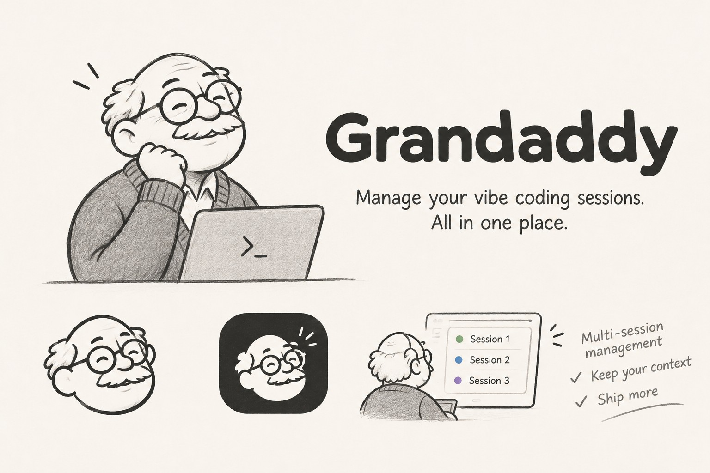

<p align="center"></p>

**grandaddy** is a terminal hub for every coding agent you have running. You can see what
each session is doing and answer whatever it's waiting on, all from one place. It also lets
you start sessions, continue old ones, set rules for what gets approved automatically, and
approve from your phone. It works best with Claude Code, and also shows Codex, Gemini and
OpenCode sessions.

```
     _.---._
  ~ /       \ ~    grandaddy
 ~ | (◠)-(◠) | ~   Manage your vibe coding sessions. All in one place.
    \  ⌒⌒⌒  /
     `-...-'       ● 1 needs you   ● 2 working   ● 1 idle   today 3.1M tokens
───────────────────────────────────────────────────────────────────────────────────────────────────────────────
 SESSIONS  4                                   │ api-refactor
  ● api-refactor               working     4m  │ claude  ·  opus-5-5  ·  pid 41822
› ● docs-site                  needs you   1m  │ ~/code/api  ·  main  ·  3 changed
  ● nightly-cleanup     bg ◆   working    12m  │ ● working for 4m  ·  context 84k  ·  1.2M tokens  ·  auto-yes off
  ● codex · web                idle        2h  │ ! docs-site also edited config.ts
                                               │
                                               │ ACTIVITY ───────────────────────────────────────────────────────────
                                               │ 14:02 › fix the flaky login test please
                                               │         Looking at the login test now.
                                               │         ▸ Bash      Run the login tests
                                               │         ✗ Exit code 1: 2 tests failed
                                               │         ▸ Read ×3   login.ts, auth.ts
                                               │         ▸ Edit      src/config.ts
                                               │         The test raced the redirect; it now waits for it.
───────────────────────────────────────────────────────────────────────────────────────────────────────────────
 [tab] next waiting  [o] jump to it  [a] auto-yes  [s] start new  [h] history  [u] usage  [?] help  [q] quit
```

## Install

```sh
git clone https://github.com/Karang1908/grandaddy.git
ln -s "$PWD/grandaddy/bin/grandaddy" ~/.local/bin/grandaddy   # anywhere on your PATH
grandaddy install                                            # once: adds a hook to ~/.claude/settings.json
grandaddy                                                    # open the hub
```

It needs only Python 3, with no extra packages. It's built and tested on macOS with
Python 3.14. Jumping to terminals and desktop notifications are macOS-only. The rest should
work on Linux, but that hasn't been tested yet. Sessions that are already running pick up
the hook straight away. Installing it doesn't approve anything on its own.

## What it does

**See everything.** Every running Claude Code session is listed, interactive and background
alike, plus Codex, Gemini and OpenCode. Each has a status: *working*, *idle*, *needs you*,
or *blocked* (a background session that can't run). Pick a session to see its live activity
as a timeline: your prompts, Claude's replies, tool calls (repeats grouped, Bash calls shown
by their description), errors and compactions. Alongside it you get model, context size,
tokens used, git branch and changed files.

**Answer from here.** Questions show up with their options: press `1`–`9` or type your own
answer (`t`). Multi-select works too. Permission prompts get `y` / `n`, and `tab` jumps to the
next session that's waiting. The prompt also stays on screen in the session's own terminal,
and whichever answer comes first wins.

**Spot trouble.** grandaddy warns when a working session has gone quiet, when it looks like
it's looping on the same tool call, when two sessions edit the same file, or when two run in
the same folder. It sends a desktop notification when a session needs you or finishes a long
stretch of work.

**Start and continue sessions.** Press `s` to start a background session in any folder,
optionally in a fresh git worktree. Press `h` to search your past sessions: `o` reopens one
in a new terminal window, `p` continues it in the background with a new prompt. `o` on a
running session takes you to its terminal, or attaches to it if it's a background one, and
`x x` stops a background session.

**auto-yes, with rules.** `a` auto-approves one session's permission prompts and `A` does it
for every session. Rules give finer control, in Claude Code's own `Tool(pattern)` syntax:

```sh
grandaddy rules add yes "Bash(npm test*)"    # approve automatically, everywhere
grandaddy rules add ask "Bash(git push*)"    # always ask, even with auto-yes on
grandaddy rules add no  "Bash(rm -rf /*)"    # refuse automatically
```

Questions are never answered for you: rules and auto-yes only cover permission prompts.

**Approve from your phone.** `grandaddy phone setup` connects the free
[ntfy](https://ntfy.sh) app. When a session needs you, your phone gets a notification with
**Allow / Deny** buttons, or one button per option for simple questions. Tapping a button
answers the prompt. Your Mac polls for replies, so nothing has to reach it from outside, and
the hub doesn't even need to be open. Prompts pass through the ntfy server, so for anything
sensitive use your own server: `grandaddy phone setup https://ntfy.example.com`.

**Usage.** Press `u` (or run `grandaddy usage`) for tokens by day and by project, counted from
your transcripts.

## Keys

| key | does |
|---|---|
| `↑` `↓` / `j` `k` | move · `tab` next session waiting on you |
| `y` / `n` | allow / deny a permission prompt |
| `1`–`9`, `enter`, `t` | answer a question (pick · send a multi-select · type your own) |
| `o` | jump to its terminal (attach, for background sessions) |
| `a` / `A` | auto-yes for this session / every session |
| `s` · `x x` | start a background session · stop one |
| `h` · `u` | past sessions · token usage |
| `m` · `i` · `?` · `q` | mute notifications · install the hook · help · quit |

## Commands

Everything the hub does also works as a command, so you can script it:

```
grandaddy ls | watch [target] | pending
grandaddy approve | deny [target]
grandaddy answer [target] 2 1,3 "my own words"      one answer per question
grandaddy auto on|off [target|--all]
grandaddy rules [add <rule> | rm <n>]
grandaddy start <prompt> [--in DIR] [--worktree [NAME]] [--model M]
grandaddy open | stop [target]
grandaddy history [search] · resume <id> [prompt]
grandaddy usage [days] · log [n]
grandaddy phone setup [server] | test | off
grandaddy install | uninstall
```

A `target` is a pid, session name, background id, session-id prefix or folder. Leave it out to
mean the session in the current folder, or the only one that's waiting.

## How it works

- **Answering:** Claude Code runs grandaddy's `PermissionRequest` hook whenever it's about
  to show a dialog, in interactive and background sessions alike. The hook checks your rules
  and auto-yes. If neither applies, it writes the request to `~/.grandaddy/pending/` and
  waits. Meanwhile the same dialog stays up in the session's terminal. The hook returns
  whichever answer comes from the hub or your phone, and gives up as soon as the session
  stops waiting. Claude ignores a hook answer that arrives after you've answered in the
  terminal, so the two never fight.
- **Sessions:** the list comes from `claude agents --json`, and status from
  `~/.claude/sessions/`. Activity, tokens and history come from the transcripts in
  `~/.claude/projects/`. Starting and continuing sessions go through `claude --bg`.
- **Other tools:** Codex activity is read from `~/.codex/sessions/`. Gemini and OpenCode
  are found from the process list.

## Limits

- Prompts can only be answered for Claude Code. For Codex, Gemini and OpenCode, `o` takes
  you to their terminal.
- You can't type into a running *interactive* session from the hub, because Claude Code has
  no supported way to do that. You can start a session, continue one that isn't running
  (`h` → `p`), or jump to its terminal.
- Jumping to the exact tab only works in Terminal and iTerm. In Ghostty and other terminals
  it brings the app to the front.
- The hook only answers in interactive sessions and `claude --bg` background sessions. In
  `claude -p` (headless mode) a hook's prompt becomes a denial before it can be answered.

## License

MIT
