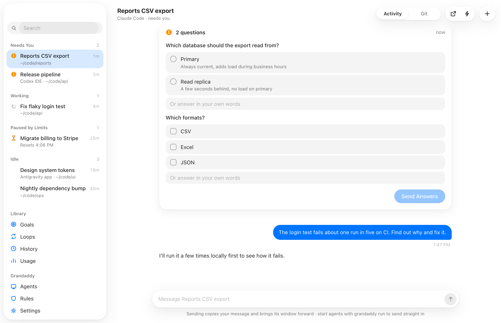
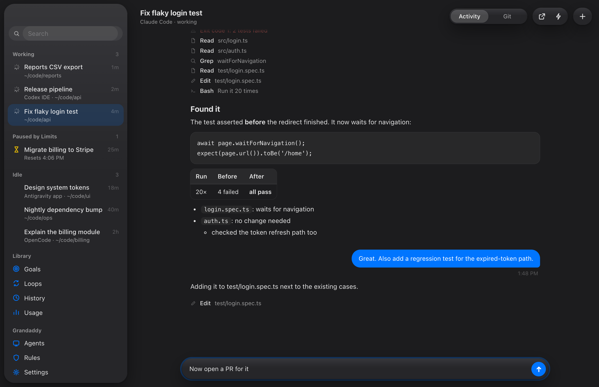
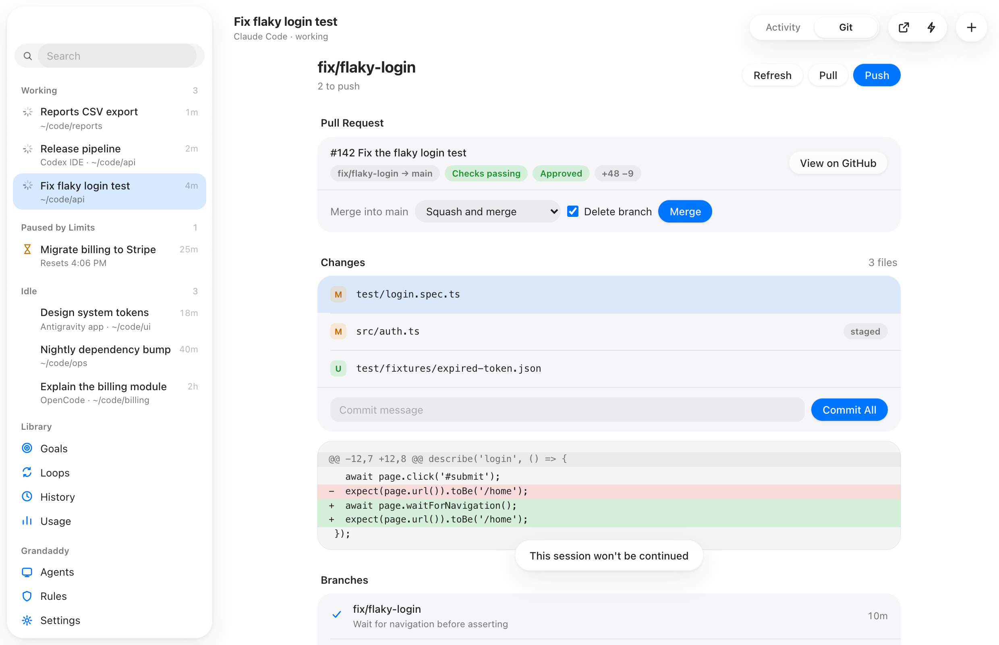
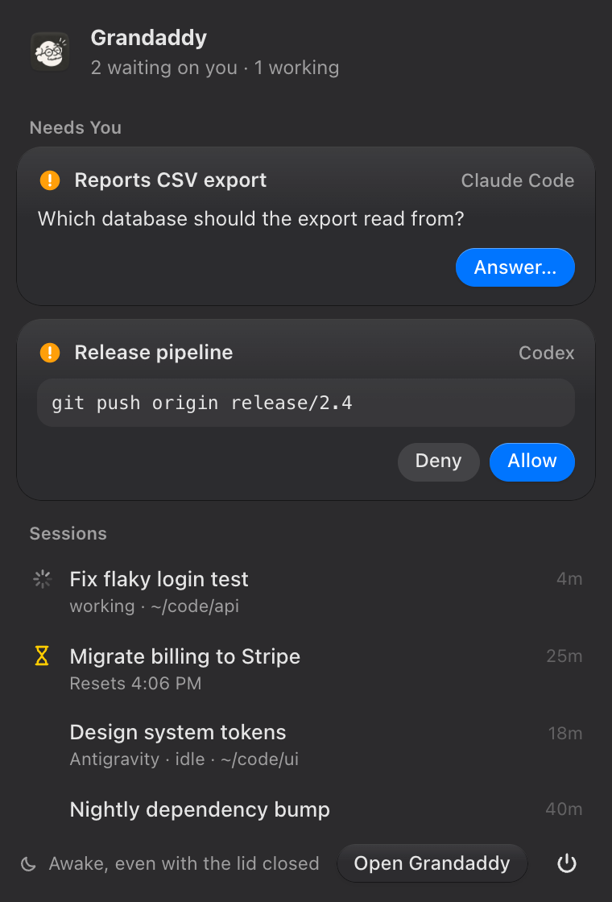

<p align="center">
  
</p>

<p align="center">
  <b>Multi-session management</b>&nbsp;&nbsp;·&nbsp;&nbsp;<b>Keep your context</b>&nbsp;&nbsp;·&nbsp;&nbsp;<b>Ship more</b>
</p>

<p align="center">
  <a href="LICENSE"></a>
  
  
  
</p>

**grandaddy** keeps an eye on every coding agent running on your Mac: Claude Code, Codex,
Antigravity, Cursor, Gemini CLI, OpenCode, Kilo and more. You can see what each one is doing,
answer what it's waiting on, and send it its next prompt, all in one place. You can also hand it
a goal and walk away: it asks what it needs to know, works on its own, and checks with you, here
or on your phone, before any big decision.

It comes two ways, both built on the same Rust core: a **Mac app** that lives in your menu bar,
and a **terminal hub and CLI**.

<p align="center">
  
  
</p>

## Install

**The app.** Build it once (Rust, plus the Tauri bundler):

```sh
git clone https://github.com/Karang1908/grandaddy.git && cd grandaddy
cargo install tauri-cli --version "^2" --locked
./scripts/build-mac.sh        # → target/release/bundle/macos/Grandaddy.app and a .dmg
cp -R target/release/bundle/macos/Grandaddy.app /Applications/
```

The `grandaddy` command ships inside the app. **Settings → Command-line tool → Link** puts it on
your PATH. In **Agents**, switch on approvals for each tool you use.

**Just the CLI:**

```sh
cargo install --path crates/grandaddy
grandaddy install all         # connect approvals for every agent it finds
```

Built and tested on macOS. The build is signed ad hoc, not notarized, so on another Mac you'll
need to right-click the app and choose Open the first time.

## Works with

| Agent | Sessions shown | Approvals from grandaddy | How |
|---|---|---|---|
| Claude Code (CLI, desktop app) | yes | permissions **and questions** | `PermissionRequest` hook |
| Codex (CLI, IDE, app) | yes | permissions | `PermissionRequest` hook (trust it once in Codex with `/hooks`) |
| Antigravity (app, IDE, `agy` CLI) | yes | permissions | `PreToolUse` hook |
| Cursor (IDE, CLI) | yes | shell and MCP calls | `beforeShellExecution` / `beforeMCPExecution` hooks |
| Gemini CLI, Qwen Code | yes | permissions (Gemini) | `BeforeTool` hook |
| OpenCode, Kilo | yes | answer in their own window | no hook API |
| Aider, Amp, Goose, Crush, Droid, Copilot CLI | while running | answer in their own window | process list |

Your rules and auto-yes cover every connected agent. Each hook replies in that agent's own
format, and anything grandaddy doesn't decide falls through to the agent's usual prompt.

## What it does

**See everything.** Every session from every agent above, grouped by what it needs from you:
*Needs You*, *Working*, *Idle*. Pick one to see its activity as a conversation (your prompts,
its replies, the steps in between) with model, folder, branch and context size above it.
Long runs of steps fold up so the words stay readable. grandaddy warns you when a session goes
quiet, seems stuck in a loop, or edits a file another session is also editing.

**Answer from anywhere.** Questions arrive with their options and room to answer in your own
words. Permission prompts get **Allow** and **Deny**. You can answer in the app, from the menu
bar, in the terminal hub, on your phone, or in the session itself. Whichever answer comes
first wins.

**Send prompts.** Each session has a message field, and the hub has `p`. To make sure your words
land in the session, start agents through grandaddy:

```sh
grandaddy run claude          # or: codex, agy, gemini, opencode, kilo, aider…
```

It looks and feels exactly as usual, but now grandaddy, loops and other sessions can type into
it, and **Open** brings its window forward. Sessions in iTerm, Terminal or tmux take prompts
too. For anything else, the prompt is copied and the window brought forward so you can paste it.

**Goals.** Describe an outcome ("add CSV export to the reports page, with tests"), pick a folder,
an agent and a model. The session asks its questions first, then works on its own, and stops to
ask before major decisions: changing scope, choosing between real alternatives, anything
destructive or that costs money. With Claude Code those questions come to grandaddy and your
phone. Goals track their session and show a summary when it's done.

**Loops.** A prompt on a schedule, sent to a session or to a fresh background session each
time. "Check CI and fix what's red, every 30 minutes." A loop waits while its session is busy,
and can stop itself once the reply contains a phrase you choose, or after a number of runs.

<p align="center">
  
</p>

**Git and pull requests.** Every session has a Git tab for its folder:
- branch and sync state, pull and push
- changed files with diffs, and Commit All
- branches: switch or create
- recent commits
- with GitHub's `gh` installed: open a pull request, see its checks and reviews, and merge it
  (squash, merge or rebase, with optional branch cleanup)

Merging asks first. Nothing ever force-pushes or force-deletes.

**Everything sleeps except the coding.** While any session is working, grandaddy keeps your Mac
from idle-sleeping. The display still sleeps and locks. Once everything is idle, it lets go.
You also choose what closing the lid does while sessions work:

- **Sleep:** as usual.
- **Keep everything on:** the whole Mac keeps running.
- **Agents only:** your agents keep running and everything else rests. The display turns off,
  every app that isn't running a session is paused (browsers, terminals and call apps stay on a
  keep list you can edit), sound is muted and Low Power Mode turns on. Opening the lid undoes all
  of it. `grandaddy awake preview` shows which apps would pause right now.

Both lid modes need your password once, for a rule that allows exactly
`pmset -a disablesleep 0|1` and `pmset -b lowpowermode 0|1`. Every change is written down before
it's made, so if grandaddy crashes, the next start, or a watchdog the moment it dies, resumes
paused apps and puts sleep back.

**Continue after usage limits.** When a session stops on its 5-hour or weekly limit, grandaddy
shows when the limit resets, and with **Continue after a usage limit resets** on, it sends the
session "continue" (or your own message) as soon as it lifts, so the work carries on overnight
without you. It reads the exact reset time Claude Code records. Turn it off for one session from
the session itself.



**From the menu bar.** Click the grandaddy icon for a panel with what's waiting (Allow and Deny
right there), every session with a field to message it, and whether it's holding your Mac awake.
The icon shows a count when something needs you. Closing the window keeps grandaddy running up
there, and **Open at login** starts it there.

**On your phone.** Two ways, and you can use both:
- **ntfy**: notifications with **Allow / Deny** buttons, wherever you are. Set it up with
  `grandaddy phone setup` or in Settings. Prompts pass through the ntfy server, so for anything
  sensitive use your own: `grandaddy phone setup https://ntfy.example.com`.
- **The phone page**: on the same Wi-Fi, scan the QR code in Settings. You can answer questions,
  follow goals and message sessions from your phone's browser. The link carries a private key.

**Rules.** Finer control than auto-yes, in Claude Code's `Tool(pattern)` syntax. They apply to
every connected agent, because shell commands from all of them are matched as `Bash`:

```sh
grandaddy rules add yes "Bash(npm test*)"    # approve automatically
grandaddy rules add ask "Bash(git push*)"    # always ask, even with auto-yes on
grandaddy rules add no  "Bash(rm -rf /*)"    # refuse
```

Questions are never answered by a rule or by auto-yes.

**Experimental: sessions that talk to each other.** Turn it on in **Agents → Experimental** (or
`grandaddy mesh on`) to add the grandaddy MCP server to your agents. A session can then list and
read other sessions, message the ones started with `grandaddy run`, and start helpers in any
agent and model, waiting for their results. A planner on one model can hand work to sessions on
others.

## The terminal hub

`grandaddy` with no arguments opens the same view in your terminal:

```
     _.---._
  ~ /       \ ~    grandaddy
 ~ | (◠)-(◠) | ~   Manage your vibe coding sessions. All in one place.
    \  ⌒⌒⌒  /
     `-...-'       ● 1 needs you   ● 2 working   ● 1 idle   today 3.1M tokens
──────────────────────────────────────────────────────────────────────────────────────────
 SESSIONS  4                        │ Fix flaky login test
  ● Fix flaky login test  working   │ Claude Code  ·  opus-5-5  ·  pid 41822
› ● Reports CSV export  needs you   │ ~/code/api  ·  fix/flaky-login  ·  3 changed
  ● Release pipeline · Codex  idle  │ ● working for 4m  ·  context 84k
```

| key | does |
|---|---|
| `↑` `↓` / `j` `k` | move · `tab` next session waiting on you |
| `y` / `n` | allow / deny a permission prompt |
| `1`–`9`, `enter`, `t` | answer a question (pick · send a multi-select · type your own) |
| `p` | send the session a prompt |
| `o` | jump to its window (attach, for background sessions) |
| `a` / `A` | auto-yes for this session / every session |
| `s` · `x x` | start a background session · stop one |
| `h` · `u` | past sessions · token usage |
| `m` · `i` · `?` · `q` | mute notifications · connect Claude Code · help · quit |

## Commands

```
grandaddy ls | watch [session] | pending
grandaddy approve | deny [session]
grandaddy answer [session] 2 1,3 "my own words"
grandaddy run <agent> [args…]                    start an agent grandaddy can type into
grandaddy send [session] <prompt> [--open]
grandaddy open | stop [session]
grandaddy start <prompt> [--in DIR] [--worktree [NAME]] [--model M]
grandaddy goal <what you want> [--in DIR] [--agent A] [--model M] [--terminal] · goal ls | rm
grandaddy loop add <prompt> --every 30m [--session S | --in DIR] [--until TEXT] [--max N]
grandaddy loop ls | pause | resume | rm <id>
grandaddy git [session] · git log | branches | prs
grandaddy git commit <message> | push | pull | branch <name> | switch <name>
grandaddy git pr <title> [--draft] · git merge <number> [--squash|--merge|--rebase] [--delete-branch]
grandaddy auto on|off [session|--all] · rules [add <rule> | rm <n>]
grandaddy remote on|off <agent>                  hold another agent's prompts for your answer
grandaddy tools · install [agent|all] · uninstall [agent]
grandaddy awake on|off · awake lid off|full|agents · awake preview
grandaddy continue on|off ["message"] · continue skip|unskip [session]
grandaddy phone setup [server] | test | off · web on|off|url
grandaddy mesh on|off · mcp install <agent|all>  (experimental)
grandaddy daemon                                 loops, staying awake and the phone page, without the app
grandaddy history [search] · resume <id> [prompt] · usage [days] · log [n]
```

A session is a pid, name, background id, session-id prefix or folder. Leave it out to mean the
session in the current folder, or the only one that's waiting.

## How it works

- **Sessions.** Claude Code comes from `claude agents --json` and its transcripts. Everything
  else is read, read-only, from where each tool keeps it: Codex rollouts in `~/.codex/sessions`,
  Antigravity transcripts in `~/.gemini/antigravity*/brain`, Gemini and Qwen chats in
  `~/.gemini/tmp` and `~/.qwen/tmp`, OpenCode and Kilo SQLite in `~/.local/share`, Cursor's chat
  store, and the Claude desktop app's session records. Terminal sessions are listed only while
  their process is running.
- **Answering.** Each agent runs `grandaddy hook --tool <agent>` before it acts. The hook checks
  your rules and auto-yes. If neither decides, it either holds the request in
  `~/.grandaddy/pending/` for an answer from grandaddy or your phone (always for Claude Code,
  whose own dialog stays up meanwhile; for other agents only with `grandaddy remote on`, for up
  to two minutes), or hands it straight back to the agent's own prompt. Installing a hook keeps
  the rest of that config file and writes a `.grandaddy.bak` copy first.
- **Usage limits.** A session's transcript records each limit stop with its exact reset time
  (`quotaLimits.resetsAt`). Auto-continue acts once per limit, 90 seconds after it lifts, and only
  in sessions it can type into or resume.
- **Typing into sessions.** `grandaddy run` starts the agent inside a terminal it owns and passes
  your keyboard through untouched. Prompts sent by grandaddy arrive as a paste, then Return.
- **Code.**
  - `crates/grandaddy-core` does the work: providers, hook, rules, goals, loops, git, staying
    awake, the phone page and the MCP server.
  - `crates/grandaddy` is the CLI and the terminal hub (ratatui).
  - `app/` is the Tauri app: Rust commands in `src-tauri`, plain HTML, CSS and JS in `ui`.
    Loops, staying awake and the phone page run inside the app, or under `grandaddy daemon`,
    never both.

## Limits

- Only Claude Code's questions can be answered from grandaddy. Other agents' permission prompts
  can be, but their questions are answered in their own window.
- Codex runs a new hook only after you trust it in Codex (`/hooks`).
- Cursor documents its hooks for the IDE. The Cursor CLI may not run them.
- Antigravity and Gemini don't record a session's folder, so grandaddy learns it the first time
  their hook runs.
- Typing straight into a session needs `grandaddy run`, iTerm, Terminal or tmux. Elsewhere the
  prompt goes to your clipboard, and auto-continue sends you a notification instead.
- Codex limits are read from the wording of its message, which grandaddy has only seen in
  documentation, not on a real session.
- Pull requests need GitHub and the `gh` command, signed in.
- The phone page is plain HTTP on your local network. Use it on networks you trust.

## License

[MIT](LICENSE)

<br>
<p align="center">
  <br>
  <sub>grandaddy keeps an eye on your sessions, so you don't have to.</sub>
</p>
